<picture><source media="(prefers-color-scheme: dark)" srcset="assets/hero-dark.svg"></picture>

<picture><source media="(prefers-color-scheme: dark)" srcset="assets/wave-dark.svg"></picture>

<picture><source media="(prefers-color-scheme: dark)" srcset="assets/social-l-dark.svg"></picture><a href="https://discord.gg/pPNcxVgwp"><picture><source media="(prefers-color-scheme: dark)" srcset="assets/social-1-dark.svg"></picture></a><a href="t.me/xihanzu"><picture><source media="(prefers-color-scheme: dark)" srcset="assets/social-2-dark.svg"></picture></a><a href="https://www.npmjs.com/~hanxthvy"><picture><source media="(prefers-color-scheme: dark)" srcset="assets/social-3-dark.svg"></picture></a><a href="Ikuti saluran hanxthvy di WhatsApp: https://whatsapp.com/channel/0029VbDeSgMBqbr1j1CFse2G"><picture><source media="(prefers-color-scheme: dark)" srcset="assets/social-4-dark.svg"></picture></a><picture><source media="(prefers-color-scheme: dark)" srcset="assets/social-r-dark.svg"></picture>

<picture><source media="(prefers-color-scheme: dark)" srcset="assets/stack-dark.svg"></picture>

<a href="https://github.com/hanxthvy/portfolio"><picture><source media="(prefers-color-scheme: dark)" srcset="assets/project-portfolio-dark.svg"></picture></a>&nbsp;<a href="https://github.com/hanxthvy/hydrascript"><picture><source media="(prefers-color-scheme: dark)" srcset="assets/project-hydrascript-dark.svg"></picture></a>

<a href="https://github.com/hanxthvy/hydrascript-llm"><picture><source media="(prefers-color-scheme: dark)" srcset="assets/project-hydrascript-llm-dark.svg"></picture></a>&nbsp;<a href="https://github.com/hanxthvy/hanxthvy"><picture><source media="(prefers-color-scheme: dark)" srcset="assets/project-hanxthvy-dark.svg"></picture></a>

<picture><source media="(prefers-color-scheme: dark)" srcset="assets/button-l-dark.svg"></picture><a href="https://hanxthvy.my.id"><picture><source media="(prefers-color-scheme: dark)" srcset="assets/button-1-dark.svg"></picture></a><a href="https://client.vy-host.my.id"><picture><source media="(prefers-color-scheme: dark)" srcset="assets/button-2-dark.svg"></picture></a><picture><source media="(prefers-color-scheme: dark)" srcset="assets/button-r-dark.svg"></picture>

<a href="https://metawka.github.io/expressive-profile/?from=hanxthvy"><picture><source media="(prefers-color-scheme: dark)" srcset="assets/credit-dark.svg"></picture></a>

